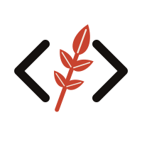

<p align="center">
  <picture>
    <source media="(prefers-color-scheme: dark)" srcset="assets/icon/mark-dark.svg">
    
  </picture>
</p>

# Urushi

A cross-platform graphical workspace for working with AI agents.

- **Projects → Threads:** projects group threads from any repo; every thread is its own git worktree and branch.
- **Tabs of split terminals:** sessions are *recoverable*. They keep running in the `urushid` daemon when the window closes, the app crashes or a client disconnects.
- **Safe deletion:** deleting a thread removes its worktree and every branch it owns, local and (by default) remote, after a warning that lists exactly what will go.
- **Remote access over Tailscale:** your phone (iOS and Android apps) or another computer can attach to the same live sessions. Only your tailnet identity is admitted.

**Stack:** all Rust. An in-house multiplexer, widget toolkit, GPU renderer (wgpu) and wire protocol (protobuf). Only permissively licensed dependencies are used ([`docs/dependencies.md`](docs/dependencies.md)).

## Quick start (macOS)

```sh
make app && open build/Urushi.app       # GUI (starts the daemon itself)
# or, during development:
cargo run -p urushi-desktop             # binary: urushi-app
```

Headless, with the CLI:

```sh
cargo build --workspace
./target/debug/urushi project add ~/code/my-repo
./target/debug/urushi thread new <project-id> "Try something"
./target/debug/urushi ls
./target/debug/urushi tailnet on        # serve on your tailnet
```

The other platforms are covered in [`docs/platforms.md`](docs/platforms.md): Linux, Windows, iOS (simulator) and Android (APK without Gradle).

## Development

```sh
make ci   # fmt, clippy -D warnings, all tests, license audit, docs check, proto lint
```

Start with [`AGENTS.md`](AGENTS.md) and [`docs/README.md`](docs/README.md).
